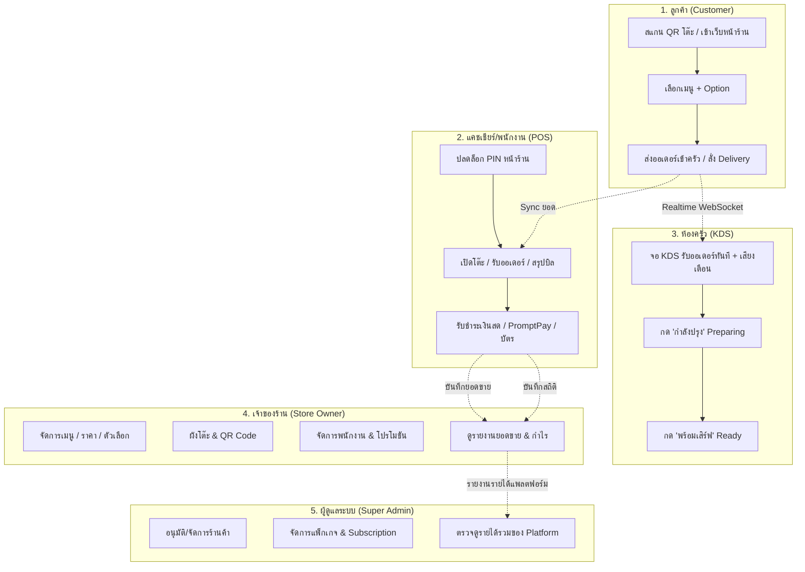
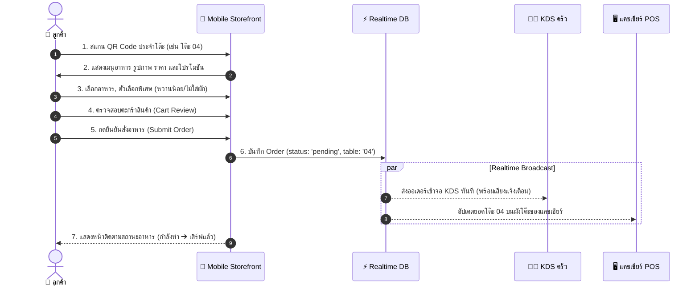
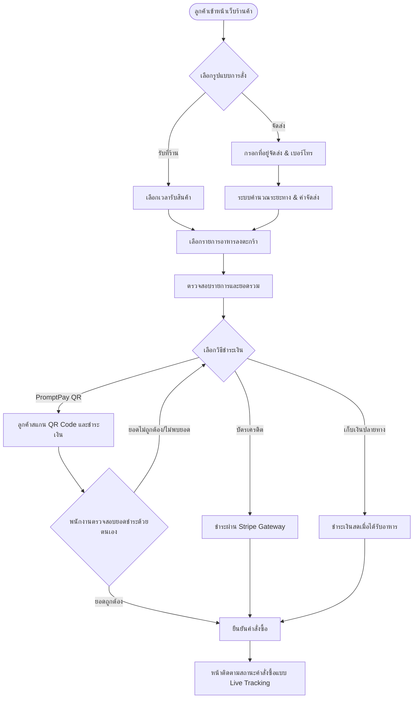
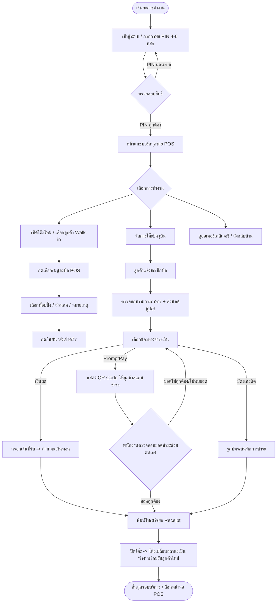
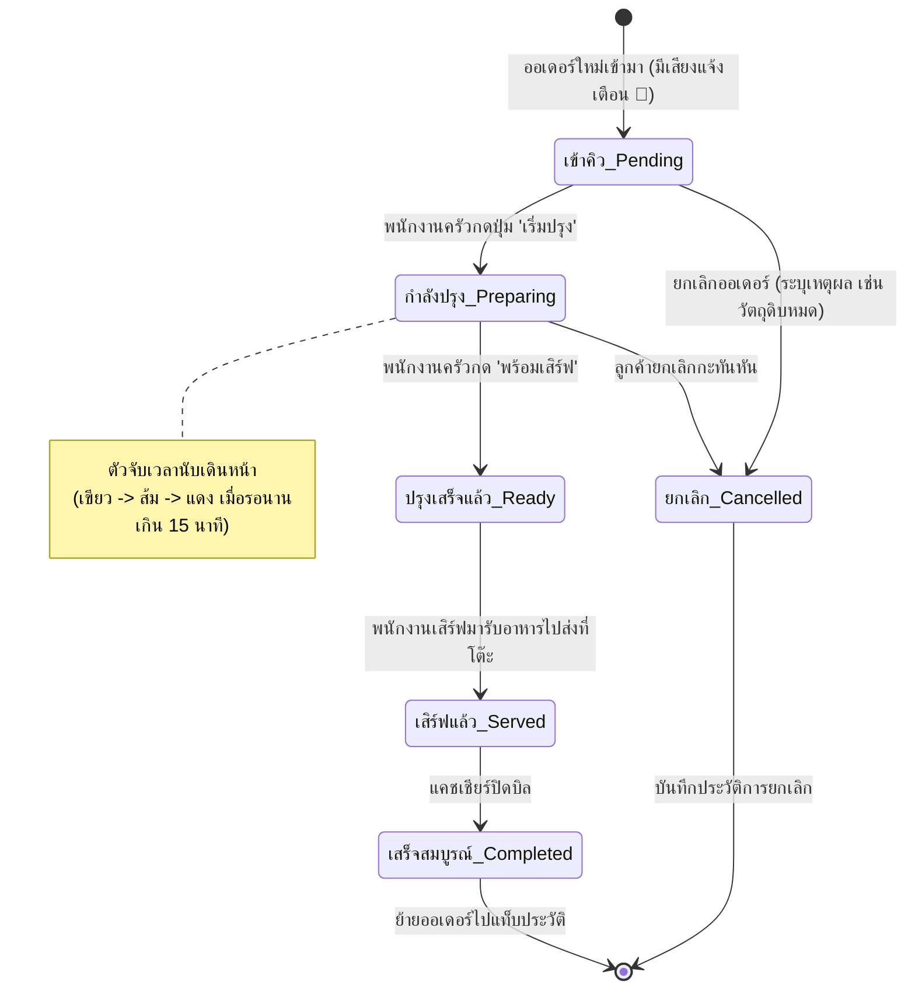
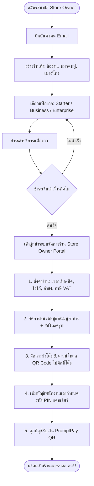
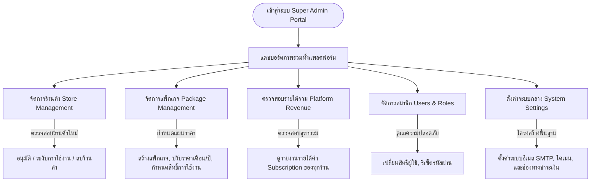
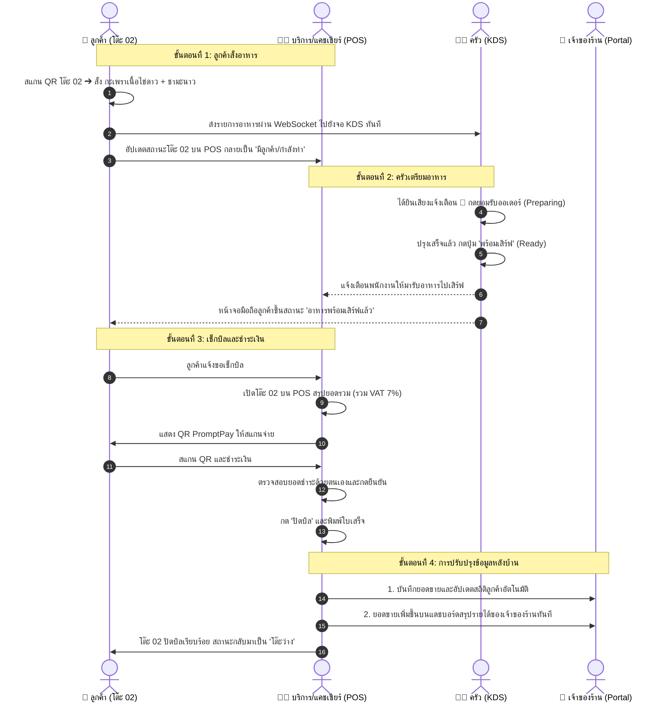
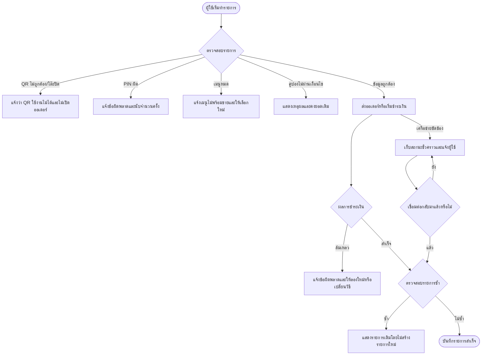

# 🗺️ SmartPOS Platform — เอกสารผังลำดับขั้นตอนการทำงานของผู้ใช้งาน (User Flow Specification)

> **โครงการ:** SmartPOS Platform (ระบบบริหารจัดการร้านอาหารและจุดขายแบบคลาวด์ Multi-tenant)  
> **เอกสารอ้างอิง:** [REQUIREMENTS.md](./REQUIREMENTS.md)

---

## สารบัญ (Table of Contents)
1. [ภาพรวมของ User Flow ในระบบ (System Architecture & Journey Overview)](#1-ภาพรวมของ-user-flow-ในระบบ)
2. [Flow 1: ลูกค้า (Customer Journey — สั่งอาหารหน้าร้าน & Delivery)](#flow-1-ลูกค้า-customer-journey)
3. [Flow 2: พนักงานแคชเชียร์และบริการ (Cashier & Service Staff Flow — POS)](#flow-2-พนักงานแคชเชียร์และบริการ-cashier--service-staff-flow)
4. [Flow 3: ห้องครัว (Kitchen Display System - KDS Flow)](#flow-3-ห้องครัว-kitchen-display-system---kds-flow)
5. [Flow 4: เจ้าของร้าน (Store Owner Flow — ตั้งค่าและจัดการร้าน)](#flow-4-เจ้าของร้าน-store-owner-flow)
6. [Flow 5: ผู้ดูแลระบบหลัก (Super Admin Flow — แพลตฟอร์มส่วนกลาง)](#flow-5-ผู้ดูแลระบบหลัก-super-admin-flow)
7. [การทำงานร่วมกันแบบเรียลไทม์ระหว่างบทบาท (Cross-Role End-to-End Flow)](#7-การทำงานร่วมกันแบบเรียลไทม์ระหว่างบทบาท-cross-role-end-to-end-flow)
8. [เส้นทางกรณีผิดพลาด (Error & Recovery Flow)](#8-เส้นทางกรณีผิดพลาด-error--recovery-flow)

---

## 1. ภาพรวมของ User Flow ในระบบ

ระบบ **SmartPOS** แบ่งกลุ่มผู้ใช้งานหลักออกเป็น 5 กลุ่มที่มีปฏิสัมพันธ์ต่อเนื่องกันแบบ Real-time:

---

## Flow 1: ลูกค้า (Customer Journey)

### 1.1 การสั่งอาหารที่โต๊ะด้วย QR Code (Dine-in QR Ordering)
ลูกค้าเดินเข้าร้าน นั่งประจำโต๊ะ และสั่งอาหารด้วยตนเองผ่านมือถือ:

**ขั้นตอนการทำงาน (Step-by-step):**
1. **สแกน QR Code:** ลูกค้าใช้กล้องมือถือสแกน QR Code ที่ติดอยู่บนโต๊ะ ระบบจะเปิดเว็บแอปพลิเคชันโดยระบุเลขโต๊ะโดยอัตโนมัติ
2. **เลือกเมนู:** ค้นหาและคัดกรองตามหมวดหมู่ (เครื่องดื่ม, อาหารจานหลัก, ของทานเล่น)
3. **ปรับแต่งรายการ (Item Customization):** เลือกขนาด, ระดับความหวาน, เพิ่มท็อปปิ้ง และระบุหมายเหตุ
4. **ยืนยันการสั่ง:** กดส่งรายการ ระบบส่งข้อมูลผ่าน Supabase Realtime ไปยังห้องครัวและแคชเชียร์ทันที
5. **ติดตามสถานะ & เรียกพนักงาน:** ลูกค้าดูสถานะการปรุงอาหาร และสามารถกดปุ่ม "เรียกพนักงาน" หรือ "ขอเช็กบิล" ได้

---

### 1.2 การสั่งอาหารแบบส่งถึงบ้าน (Delivery Order)

---

## Flow 2: พนักงานแคชเชียร์และบริการ (Cashier & Service Staff Flow)

---

## Flow 3: ห้องครัว (Kitchen Display System - KDS Flow)

---

## Flow 4: เจ้าของร้าน (Store Owner Flow)

### 4.1 การตั้งค่าเริ่มต้นและการเตรียมเปิดร้าน (Store Onboarding & Setup)

### 4.2 การจัดการประจำวัน (Daily Management & Operations)
- **จัดการโปรโมชัน (Promotions):** สร้างโค้ดส่วนลด กำหนดวันหมดอายุและเงื่อนไขยอดซื้อขั้นต่ำ
- **จัดการลูกค้า (Customer Management):** ดูข้อมูลลูกค้า ประวัติคำสั่งซื้อ จำนวนครั้งที่ใช้บริการ และยอดซื้อสะสมเฉพาะภายในร้านของตนเอง
- **จัดการ Subscription:** ดูแพ็กเกจ สถานะ วันหมดอายุ ต่ออายุหรือยกเลิกบริการ และตรวจสอบสิทธิ์ของแพ็กเกจ
- **รายงานและการเงิน (Reports & Analytics):**
  - กราฟสรุปยอดขายแบบ Live (วันนี้, สัปดาห์นี้, เดือนนี้)
  - รายงานสินค้าขายดี (Top Sellers) และช่วงเวลายอดฮิต (Peak Hours)
  - ส่งออกไฟล์รายงานยอดขาย (Export CSV / PDF) เพื่อส่งฝ่ายบัญชี

---

## Flow 5: ผู้ดูแลระบบหลัก (Super Admin Flow)

---

## 7. การทำงานร่วมกันแบบเรียลไทม์ระหว่างบทบาท (Cross-Role End-to-End Flow)

ตัวอย่างลำดับเหตุการณ์จริงเมื่อมีลูกค้าเดินเข้ามาทานอาหารในร้าน:

---

## 8. เส้นทางกรณีผิดพลาด (Error & Recovery Flow)

---

## สรุปคุณสมบัติเด่นของ User Flow ใน SmartPOS
1. **Near Real-time Synchronization:** ทุกการกระทำ (สั่งอาหาร, เปลี่ยนสถานะครัว, ชำระเงิน) ซิงค์ข้อมูลผ่าน Supabase Realtime โดย POS และ KDS ต้องได้รับอัปเดตภายใน 500 มิลลิวินาที
2. **Device Independence:** ใช้งานได้บนทุกอุปกรณ์ (iPad, Android Tablet, สมาร์ตโฟน, คอมพิวเตอร์ PC หน้าร้าน)
3. **Role Segregation (ความปลอดภัยแยกตามหน้าที่):** พนักงานหน้าร้านใช้รหัส PIN เข้าถึงเฉพาะ POS/KDS โดยไม่สามารถเข้าถึงข้อมูลการเงินส่วนตัวของเจ้าของร้านได้
4. **Bilingual Support:** สลับใช้งานภาษาไทยและภาษาอังกฤษได้ลื่นไหลทุกจุดสัมผัส (Touchpoints)
